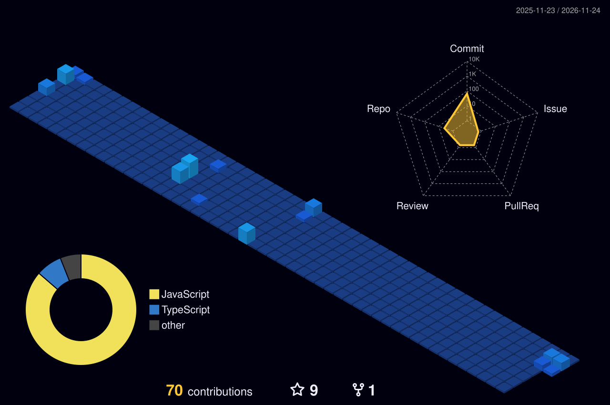

## 🚀 Featured Projects

| Project | What it is |
| ------- | ---------- |
| [**web-calculator**](https://github.com/vic-tech7/web-calculator) | VEC Scientific Web Calculator: a modern scientific calculator with AI assistance, calculation history and a futuristic interface. |
| **VECTOR AI** | An AI-focused project exploring intelligent tools and AI-powered digital experiences. |
| **VelvetTone** | A Spotify-inspired music streaming web experience with a modern interface and music discovery features. |
| [**VECTOR TECH**](https://vector-tech.netlify.app) | My technology brand: software, websites, apps, AI and digital innovation. |

[GitHub](https://github.com/vic-tech7) · [LinkedIn](https://www.linkedin.com/in/victor-dibie-dev-tech) · [Instagram](https://www.instagram.com/official_vectortech) · [TikTok](https://www.tiktok.com/@official_vectortech) · [WhatsApp Channel](https://whatsapp.com/channel/0029VbCrIl484Om8f9fCr73A) · [Email](mailto:vectordevtech@gmail.com) · [Website](https://vector-tech.netlify.app)

**BUILD. CODE. INNOVATE.**

© 2026 CHAD FDEV. All Rights Reserved.

